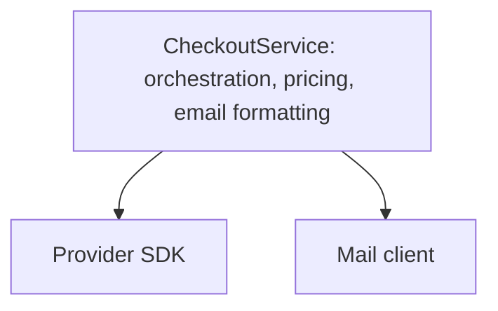
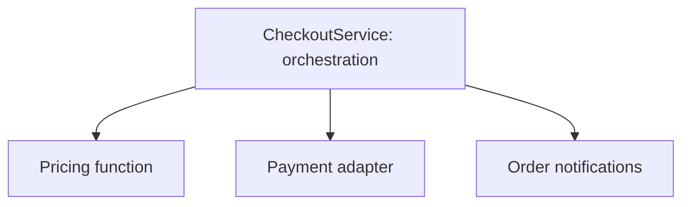

# Illustrative review

Hypothetical code: CheckoutService calculates discounts, constructs a provider SDK, charges, and formats an email internally. This is illustrative, not a finding about a real repository.

## Middle Developer Test: PARTIAL
The business goal is clear but its flow is mixed with pricing and provider mechanics.

## Current architecture

## Proposed architecture

## Findings
- Pricing changes currently affect checkout internals. Extract the pricing rule into a cohesive function if it is independently evolving.
- Provider mechanics are mixed into checkout. Inject a narrow payment contract if provider isolation is useful; keep the current implementation only.
- Notifications own email formatting, not checkout. Preserve existing ordering and failure behavior during any refactor.

## Verdict: NEEDS IMPROVEMENT
The main flow becomes easier to read and changes remain local. The cost is extra navigation across three boundaries; only introduce those with genuine independent responsibilities.

# Counterexample: PASS
A short function validates an input and maps it into a domain value. Its purpose and error contract are clear, it has no hidden effects, and changing validation is local. Do not introduce Validator, Factory and Adapter classes just to make the diagram look architectural. A single node is a sufficient diagram.
