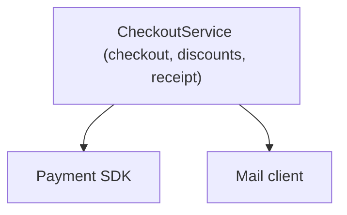
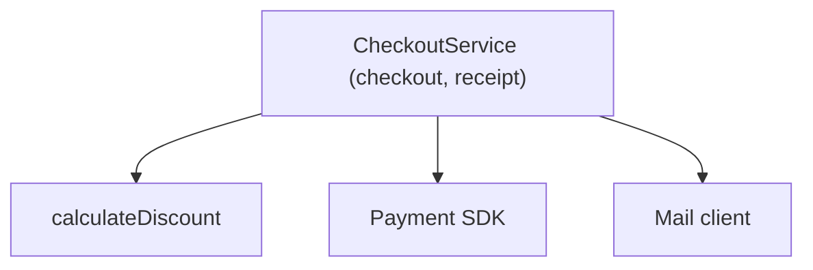

# Illustrative review

In this hypothetical checkout subsystem, `CheckoutService` calculates discounts inline, charges through a payment SDK, and formats and sends a receipt. Discount rules change independently as promotions are added. To update or test a rule, developers currently work through the checkout flow, which requires payment and mail test doubles.

## Readability (0–100)

**60/100.** The checkout goal is clear. To tell which branches affect the charge amount, a reader has to follow the inline discount rules through the checkout flow.

## Current architecture



## Proposed architecture

The discount calculation is the only new node.



## Findings and recommendations

- The inline discount branches in `CheckoutService` tie promotion changes and tests to payment and mail setup. Extract `calculateDiscount` as a pure function that takes the inputs the existing rules use. Call it at the same point in the flow, preserving discount rules, rounding, and the order of payment and receipt actions.

## Verdict

**NEEDS IMPROVEMENT.** Promotion changes and tests become local to the discount calculation. The cost is one extra function to open when investigating pricing.

# Counterexample: PASS
**95/100.** A short function validates an input and maps it into a domain value. Its purpose and error contract are clear, it has no hidden effects, and changing validation is local. Do not introduce Validator, Factory and Adapter classes just to make the diagram look architectural. A single node is a sufficient diagram.

# Optional simplification on PASS

In a hypothetical Go 1.23 project, a loop over a list of allowed roles returns true on the first equal string and false otherwise.

**90/100.** The membership test is easy to follow and the role check works. A simpler way to express the same membership test is:

```go
return slices.Contains(allowedRoles, role)
```

The standard library package `slices` is available on the project's Go version. The call replaces the loop and its early return, makes the membership test explicit, and keeps the behavior for empty lists and duplicate roles. The review can still return PASS.
